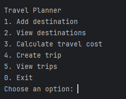
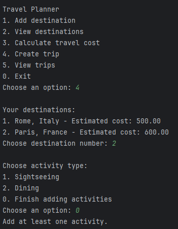
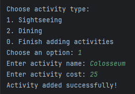
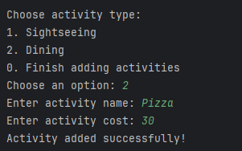
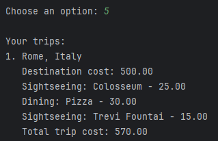
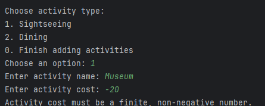
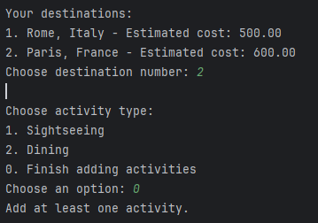

# Laboratory Work 1 – Creational Design Patterns

### Course: Techniques and Mechanisms of Software Design (TMPS)

### Project: Travel Planner

### Student: Felicia Ojog

### Academic Group: FAF-243

### Programming Language: Java

### Development Environment: IntelliJ IDEA

## 1. Introduction

The purpose of this laboratory work is to study and implement three creational design patterns in Java: **Singleton**, **Builder**, and **Factory Method**. Creational patterns organize how objects are created, helping separate construction logic from the code that uses the resulting objects.

The laboratory extends the existing Travel Planner console application developed for Lab 0. The earlier features—adding destinations, displaying them, and calculating standard or student-discounted destination costs—remain available. The new functionality allows users to create a trip based on a previously saved destination, add multiple sightseeing and dining activities with individual estimated costs, and view the total estimated trip cost.

All data is stored in memory while the application runs. No database, external API, or predefined travel dataset is required.

## 2. Creational Design Patterns

### 2.1 Overview

Creational design patterns deal with object creation. They can make code more flexible by controlling the creation process, avoiding unnecessary dependence on concrete classes, or simplifying the construction of objects with several components.

Five commonly studied creational patterns are:

1. **Singleton** — provides a shared access point to one instance of a class.
2. **Builder** — constructs a complex object step by step.
3. **Prototype** — creates new objects by copying an existing object.
4. **Factory Method** — delegates the choice of concrete product to specialized creator classes.
5. **Abstract Factory** — provides an interface for creating families of related objects.

This laboratory implements the first, second, and fourth patterns: Singleton, Builder, and Factory Method.

### 2.2 Singleton — `Singleton.java`

The **Singleton** pattern ensures that application code uses a single shared instance of a class through a controlled access method.

In the Travel Planner, `TripManager` implements Singleton. It holds the list of trips created during the application's execution. A private constructor prevents ordinary code from constructing another manager, a private static field holds the instance, and `getInstance()` returns it.

```java
class TripManager {
    private static final TripManager INSTANCE = new TripManager();
    private final List<Trip> trips = new ArrayList<>();

    private TripManager() { }

    public static TripManager getInstance() {
        return INSTANCE;
    }

    public void addTrip(Trip trip) {
        if (trip == null) {
            throw new IllegalArgumentException("Trip is required.");
        }
        trips.add(trip);
    }

    public List<Trip> getTrips() {
        return List.copyOf(trips);
    }
}
```

The main application retrieves the shared manager with:

```java
TripManager tripManager = TripManager.getInstance();
```

All calls to `getInstance()` return the same `TripManager` object during a single run of this application. Returning `List.copyOf(trips)` also prevents callers from directly modifying the manager's list.

### 2.3 Builder — `Builder.java`

The **Builder** pattern separates the construction of an object from its final representation. It is useful when an object is assembled gradually or may contain a variable number of components.

In this project, `Trip.Builder` constructs a trip from an existing `Destination` and a list of activities. Activities are added one at a time, and `build()` creates the finished `Trip`. A trip must have a destination and at least one activity. The number of days is not requested or stored in this version.

```java
Trip.Builder builder = new Trip.Builder(tripDestination);

builder.addActivity(activity);

Trip trip = builder.build();
```

The Builder supports repeated calls to `addActivity()`:

```java
Trip trip = new Trip.Builder(destination)
        .addActivity(sightseeingActivity)
        .addActivity(diningActivity)
        .build();
```

A private `Trip` constructor accepts the Builder, and the activity collection is copied into the completed trip:

```java
private Trip(Builder builder) {
    this.destination = builder.destination;
    this.activities = List.copyOf(builder.activities);
}
```

Trip totals are computed as the destination's estimated base cost plus the estimated costs of all activities:

```java
public double getTotalCost() {
    double total = destination.getEstimatedCost();

    for (Activity activity : activities) {
        total += activity.getCost();
    }

    return total;
}
```

For example, the tested Rome trip has a destination cost of 500, sightseeing activities costing 25 and 15, and a dining activity costing 30. Its estimated total is **570**. These are user-entered estimates, not real-world prices.

### 2.4 Factory Method — `FactoryMethod.java`

The **Factory Method** pattern defines an object-creation method while allowing subclasses of the creator to decide which concrete object is produced.

Here, `ActivityCreator` declares the factory method `createActivity()`. The two concrete creators, `SightseeingCreator` and `DiningCreator`, override that method to construct different activity classes.

```java
abstract class ActivityCreator {
    public abstract Activity createActivity(String name, double cost);

    protected void validate(String name, double cost) {
        if (name == null || name.isBlank() ||
                !Double.isFinite(cost) || cost < 0) {
            throw new IllegalArgumentException("Invalid activity name or cost.");
        }
    }
}
```

```java
class SightseeingCreator extends ActivityCreator {
    @Override
    public Activity createActivity(String name, double cost) {
        validate(name, cost);
        return new SightseeingActivity(name.trim(), cost);
    }
}

class DiningCreator extends ActivityCreator {
    @Override
    public Activity createActivity(String name, double cost) {
        validate(name, cost);
        return new DiningActivity(name.trim(), cost);
    }
}
```

Both `SightseeingActivity` and `DiningActivity` implement the `Activity` interface, which provides `getName()`, `getType()`, and `getCost()`. Each activity has its own name and user-entered estimated cost; there are no fixed prices for activity categories.

In `Main.java`, the selected creator creates the requested activity:

```java
ActivityCreator creator = new SightseeingCreator();
Activity activity = creator.createActivity("Colosseum", 25);
```

This demonstrates Factory Method rather than a simple factory because separate creator subclasses override the creation method to select a concrete activity class.

## 3. Implementation

### 3.1 Project structure

The project builds upon Lab 0 and contains the following Java source files:

```text
TravelPlanner/
  src/
    Main.java
    SingleResponsibility.java
    OpenClosed.java
    DependencyInversion.java
    Singleton.java
    Builder.java
    FactoryMethod.java
  lab0/
    README.md
    screenshots/
  lab1/
    README.md
    screenshots/
  README.md
```

The first four Java files retain the previous application's SOLID-based destination and pricing functionality. The three new pattern-specific files implement trip management, trip construction, and activity creation. `Main.java` integrates the new operations into the console menu.

### 3.2 Application workflow

The menu offers the following actions:

```text
Travel Planner
1. Add destination
2. View destinations
3. Calculate travel cost
4. Create trip
5. View trips
0. Exit
```

To create a trip, the user first adds or selects a saved destination. The application then creates a `Trip.Builder` for that `Destination`. The user can repeatedly select **Sightseeing** or **Dining**, enter an activity name and its individual estimated cost, and add that activity to the Builder. Choosing **0** finishes activity entry; the trip is built and saved through the shared `TripManager` instance. At least one activity is required.

The **View trips** option displays the destination, its base cost, all the trip's activities, and the total estimated cost. The existing **Calculate travel cost** option still calculates standard or student-discounted *destination* pricing separately; the trip total sums the base destination cost and activity costs without applying that discount.

### 3.3 Input validation

The application handles invalid menu choices, invalid destination numbers, empty activity names, nonnumeric or negative activity costs, and invalid activity types. Attempting to finish a trip with no activities displays a message requiring at least one activity. Destinations and trips are held in memory and are not saved after the application exits.

### 3.4 Testing and results

The following screenshots document the application functionality and validation during testing in IntelliJ IDEA.

**Figure 1. Travel Planner main menu**



The menu includes the original destination operations and the new trip creation and viewing options.

**Figure 2. Destination selection for trip creation**



A trip is created using a destination already added through the Lab 0 functionality.

**Figure 3. Adding a sightseeing activity**



The sightseeing creator constructs an activity from the entered name and cost.

**Figure 4. Adding a dining activity to the same trip**



The user can add further activities of a different type before completing the trip.

**Figure 5. Completed trip with activities and total cost**



The trip display lists the Rome destination cost (500.00), Colosseum (25.00), Pizza (30.00), and Trevi Fountain (15.00), giving a total of 570.00.

**Figure 6. Input validation during trip creation**



Invalid activity input is rejected without creating an invalid activity.

**Figure 7. Requiring at least one activity**



The program prevents the Builder from finishing a trip before an activity has been added.

### 3.5 How to run

1. Open the existing Travel Planner project in IntelliJ IDEA.
2. Ensure all seven Java source files are in `src/` and a compatible JDK is configured.
3. Run the `main()` method in `Main.java`.
4. Use the menu to add a destination, create a trip, enter multiple activities, and view the resulting trip.

No third-party libraries, external APIs, or databases are required.

## 4. Conclusion

This laboratory extended the existing Java Travel Planner application by implementing three creational design patterns: Singleton, Builder, and Factory Method. The added functionality remains connected to the earlier SOLID-based design because new trips are constructed from destinations already managed by the application.

The **Singleton** pattern was implemented through `TripManager`, which provides a shared instance responsible for storing the trips created during execution. The private constructor and static access method demonstrate how access to the manager is controlled, while the list of trips remains encapsulated within the class.

The **Builder** pattern was implemented through `Trip.Builder`, which assembles a trip step by step. The user can add several activities before producing the final trip object, and the Builder validates that the destination exists and at least one activity has been supplied. This structure is more flexible than a constructor requiring a fixed number of activity parameters.

The **Factory Method** pattern was implemented through an abstract activity creator and specialized sightseeing and dining creators. These classes select the concrete activity type through overridden creation methods. Each activity stores its own estimated cost, allowing the trip total to reflect the activities selected by the user rather than a fixed amount for each category.

The updated application preserves the destination management and pricing features from Lab 0 while introducing trip construction and cost aggregation. The implementation uses Java interfaces, class hierarchies, constructors, collections, validation, and polymorphism to connect the patterns to a practical user workflow. The next step is to document the tested execution results with console screenshots.

Overall, the laboratory demonstrates how creational patterns can simplify object construction and organize the responsibilities involved in creating related objects. The resulting project remains small and understandable while providing a foundation for additional functionality in future TMPS laboratory works.
