# Laboratory Work 2 - Structural Design Patterns

### Course: Techniques and Mechanisms of Software Design (TMPS)

### Project: Travel Planner

### Student:

### Academic Group: FAF-243

### Programming Language: Java

### Development Environment: IntelliJ IDEA

## 1. Introduction

The purpose of this laboratory work is to study and implement structural design patterns in Java and integrate them into an existing application. Structural patterns define ways of combining classes and objects so that a system can provide additional functionality without making individual components unnecessarily dependent on one another.

This laboratory extends the Travel Planner console application developed in Labs 0 and 1. Lab 0 introduced destination management and travel-cost calculation using SOLID principles. Lab 1 introduced Singleton, Builder, and Factory Method for storing trips, constructing trips with multiple activities, and creating different activity types.

Lab 2 adds three structural patterns: **Composite**, **Decorator**, and **Facade**. The user can organize sightseeing and dining activities into categories, include optional insurance or airport transfer in the trip price, and create trips through a simplified application interface. The patterns participate in the same trip-creation workflow rather than being demonstrated through isolated examples.

The application uses user-entered estimated costs and stores its data in memory. It does not make real travel bookings or request prices from external services. The domain model consists of destinations, individual sightseeing and dining activities, trips made from those activities, and bookings associating each trip with a calculated price.

### 1.1 Application Domain

Travel Planner is an in-memory Java console application for managing destinations and creating estimated travel plans. A user selects a destination, adds one or more sightseeing or dining activities, and optionally includes travel insurance or airport transfer fees. The saved trip view displays category totals and a detailed final price. The software is an estimator and does not perform actual reservations.

## 2. Structural Design Patterns

### 2.1 Overview

Structural design patterns focus on relationships between objects and classes. The principal structural patterns include Adapter, Bridge, Composite, Decorator, Facade, Flyweight, and Proxy. Each addresses a different problem, such as adapting interfaces, organizing hierarchies, adding behavior, or simplifying access to a subsystem.

This laboratory implements the following three patterns:

1. **Composite:** treats individual activities and activity groups through the same `Activity` interface.
2. **Decorator:** extends the calculated trip price with optional services without changing the `Trip` model.
3. **Facade:** provides a simplified interface for destination management, activity creation, trip construction, pricing, and storage.

### 2.2 Composite - `ActivityGroup.java`

The **Composite** pattern allows individual objects and groups of objects to be handled through a common interface. It is useful when the objects form a hierarchy and operations such as cost calculation should work for both single items and collections.

The existing `Activity` interface is the **Component**. `SightseeingActivity` and `DiningActivity` are the **Leaves**, representing individual activities. The new `ActivityGroup` class is the **Composite**: it implements `Activity` and contains a `List<Activity>`. A group can therefore contain leaves as well as other groups.

**Source:** [ActivityGroup.java](../src/main/patterns/structural/composite/ActivityGroup.java) (also see [Activity.java](../src/main/model/Activity.java)).

The following excerpt is the `getCost()` method of `ActivityGroup`:

```java
@Override
public double getCost() {
    double total = 0;

    for (Activity activity : activities) {
        total += activity.getCost();
    }

    return total;
}
```

Each child is accessed through `Activity.getCost()`. If the child is another `ActivityGroup`, the same method sums its children recursively. The class also implements `addActivity()` and checks for invalid circular group references.

**UML Class Diagram: Composite**

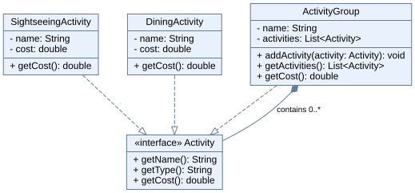

For example, sightseeing activities costing 10.00 and 29.00 produce a category total of 39.00. Dining activities costing 10.00 and 13.00 produce 23.00. The overall group returns 62.00. Additional nested groups can be added without changing `Trip` or the existing `Activity` interface.

**Automated unit tests for Composite:** [CompositeTests.java](../src/test/tests/CompositeTests.java)

| Test method | Property verified | Result |
|---|---|---|
| `testLeavesAndGroupsShareInterface()` | Both a `SightseeingActivity` leaf and an `ActivityGroup` can be used as `Activity`; the group's list contains the leaf and both return its cost of 10.00. | PASS |
| `testNestedGroupsCalculateTotal()` | Sightseeing (39.00) and Dining (23.00) are nested inside a parent group which returns 62.00, with exactly two category children. | PASS |

The results are visible in Figure 8 below, and the recorded output is in [test-results.txt](test-results.txt).

### 2.3 Decorator - Trip Pricing

The **Decorator** pattern adds behavior to an object by wrapping it in another object implementing the same interface. In this application, decorators add user-selected estimated service costs to a trip's base price.

The roles are:

- **Component:** `TripPrice` defines `getCost()`, `getDescription()`, and `getBreakdown()`.
- **Concrete Component:** `BasicTripPrice` calculates the cost of the destination and its activities from `Trip`.
- **Base Decorator:** `TripPriceDecorator` stores the wrapped `TripPrice` and delegates operations to it.
- **Concrete Decorators:** `InsuranceDecorator` and `AirportTransferDecorator` each add a fee.
- **Value record:** `PriceItem` represents an individual entry in the displayed price breakdown.

**Source:** [InsuranceDecorator.java](../src/main/patterns/structural/decorator/InsuranceDecorator.java), [TripPriceDecorator.java](../src/main/patterns/structural/decorator/TripPriceDecorator.java), and [TripPrice.java](../src/main/patterns/structural/decorator/TripPrice.java).

The following methods from `InsuranceDecorator` illustrate delegation to the wrapped component and extension of its behavior:

```java
@Override
public double getCost() {
    return super.getCost() + fee;
}

@Override
public String getDescription() {
    return super.getDescription() + ", Travel insurance";
}

@Override
public List<PriceItem> getBreakdown() {
    List<PriceItem> items = new ArrayList<>(super.getBreakdown());
    items.add(new PriceItem("Travel insurance", fee));
    return List.copyOf(items);
}
```

Here `super` delegates to `TripPriceDecorator`, which calls the wrapped `TripPrice`. The insurance decorator adds only its own fee and breakdown item, so stacking it with `AirportTransferDecorator` retains earlier calculations. In `TravelPlannerFacade.createTrip()`, the application starts with `BasicTripPrice` and applies each optional decorator when its selected cost is positive.

**UML Class Diagram: Decorator**

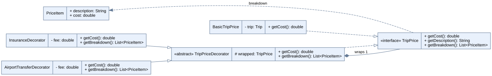

`TripBooking` stores a `Trip` and the corresponding decorated `TripPrice`. `TripManager` remains a Singleton, but it now stores completed `TripBooking` objects instead of only base trips. This preserves the association between each trip's activities and its final estimated price.

For example, the Rome trip shown in the screenshots has a base cost of 363.00, plus insurance of 150.00 and airport transfer of 12.00, for a final total of 525.00. Both optional components can be composed in either order while preserving the same final total.

**Automated unit tests for Decorator:** [DecoratorTests.java](../src/test/tests/DecoratorTests.java)

| Test method | Property verified | Result |
|---|---|---|
| `testStackingAndPriceBreakdown()` | A base price of 230.00 plus insurance 100.00 and transfer 50.00 produces 380.00 and three corresponding breakdown items. | PASS |
| `testWrappingDoesNotChangeBase()` | Applying the two decorators in either order yields 380.00 while the original `BasicTripPrice` and `Trip` still return 230.00. | PASS |

The results are visible in Figure 8 below, and the recorded output is in [test-results.txt](test-results.txt).

### 2.4 Facade - `TravelPlannerFacade.java`

The **Facade** pattern presents a simplified interface to a subsystem containing several interacting classes. The client no longer needs to coordinate each subsystem component itself.

`TravelPlanner` is the client-facing **Facade interface**, and `TravelPlannerFacade` is its implementation. `Main.java` remains responsible for console input and output, while the Facade coordinates the existing models, SOLID services, and design patterns.

**Source:** [TravelPlannerFacade.java](../src/main/patterns/structural/facade/TravelPlannerFacade.java), [TravelPlanner.java](../src/main/patterns/structural/facade/TravelPlanner.java), and [Main.java](../src/main/app/Main.java).

The following excerpt from `TravelPlannerFacade.createTrip()` illustrates how the Facade coordinates the Builder, Decorator, booking model, and Singleton:

```java
TripBuilder builder = new TripBuilder(destination);
builder.addActivity(tripActivities);
Trip trip = builder.build();
TripPrice price = new BasicTripPrice(trip);

if (insuranceCost > 0) {
price = new InsuranceDecorator(price, insuranceCost);
}

        if (transferCost > 0) {
price = new AirportTransferDecorator(price, transferCost);
}

        tripManager.addBooking(new TripBooking(trip, price));
```

Earlier in the same method, the Facade validates inputs and constructs nested Sightseeing and Dining `ActivityGroup` objects. The client calls `TravelPlanner.createTrip(...)` instead of coordinating the subsystem classes directly. `Main.java` is responsible mainly for console input and display.

**UML Class Diagram: Facade**

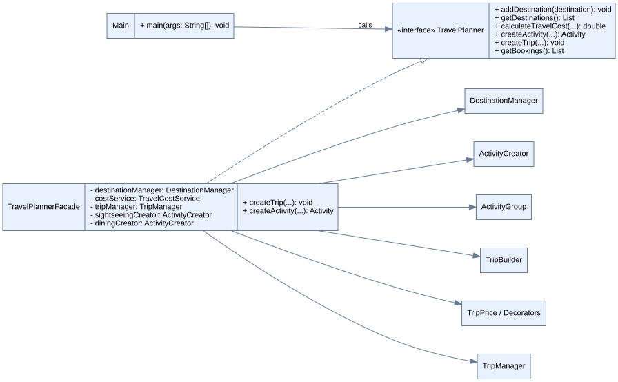

This reduces the number of subsystem classes that `Main.java` must know about. A separate `TravelPlanner` interface is not required by the classical pattern, but it allows the console to depend on an abstraction. The underlying subsystem classes remain available if a different client requires lower-level control.

**Automated unit tests for Facade:** [FacadeTests.java](../src/test/tests/FacadeTests.java)

| Test method | Property verified | Result |
|---|---|---|
| `testFullTripCreation()` | One Facade call saves a booking with a Composite activity group, decorated price breakdown, and expected price 380.00, thereby exercising the Builder and Singleton storage. | PASS |
| `testDestinationCostAndNoExtras()` | The Facade saves and retrieves a destination, returns standard 600.00 and student 540.00 costs, and creates a 630.00 trip without extra decorators. | PASS |

The tests check the resulting subsystem state and output values after calling the public Facade operations. Results appear in Figure 8 below, with the exact output in [test-results.txt](test-results.txt).

## 3. Implementation

### 3.1 Project Structure

The application continues using the same IntelliJ project and preserves the earlier laboratories' documentation.

```text
TravelPlanner/
  lab0/
    README.md
    screenshots/
  lab1/
    README.md
    diagrams/
    screenshots/
  lab2/
    REPORT.md
    diagrams/
    screenshots/
    test-results.txt
  src/
    main/
      app/
        Main.java
      model/
        Activity.java
        Destination.java
        DiningActivity.java
        SightseeingActivity.java
        Trip.java
        TripBooking.java
      solid/
        CostCalculator.java
        StandardCostCalculator.java
        StudentCostCalculator.java
        TravelCostService.java
        DestinationRepository.java
        InMemoryDestinationRepository.java
        DestinationManager.java
        DestinationDisplay.java
      patterns/
        creational/
          builder/TripBuilder.java
          factorymethod/
            ActivityCreator.java
            SightseeingCreator.java
            DiningCreator.java
          singleton/
            TripManager.java
        structural/
          composite/
            ActivityGroup.java
          decorator/
            TripPrice.java
            BasicTripPrice.java
            TripPriceDecorator.java
            InsuranceDecorator.java
            AirportTransferDecorator.java
            PriceItem.java
          facade/
            TravelPlanner.java
            TravelPlannerFacade.java
    test/
      tests/
        AllTests.java
        Checks.java
        CompositeTests.java
        DecoratorTests.java
        FacadeTests.java
```

The Builder, Factory Method, and Singleton implementations from Lab 1 remain integrated in the current application. The structural patterns are grouped into subpackages because each has a distinct role.

### 3.2 Application Workflow

The main menu retains the previous options: add a destination, view destinations, calculate travel cost, create a trip, view trips, and exit. When creating a trip, the user selects an existing destination and enters at least one activity. The Facade creates the activity objects, organizes them by category, builds the trip, and applies the optional pricing decorators.

The **View trips** option displays the destination price, activity categories and their totals, the base trip cost, each selected additional service, and the final cost. The standard/student discount option remains a separate calculation on the destination's estimated cost; it is not automatically applied to saved trips.

### 3.3 Pattern Integration

A single trip-creation operation combines the implementations from different laboratories:

```text
Main.java
   -> TravelPlannerFacade             [Facade]
       -> ActivityCreator             [Factory Method]
       -> ActivityGroup               [Composite]
       -> TripBuilder                 [Builder]
       -> BasicTripPrice              [Decorator component]
           -> InsuranceDecorator      [Decorator, optional]
           -> AirportTransferDecorator [Decorator, optional]
       -> TripBooking
       -> TripManager                 [Singleton]
```

The client primarily interacts with the Facade, and the Facade coordinates the other patterns in an ordinary application workflow.

### 3.4 Input Validation

The program checks invalid menu options, invalid destination selections, empty activity names, nonnumeric or negative costs, and the requirement to add at least one activity. Insurance and airport transfer costs must be finite and nonnegative. `ActivityGroup` rejects null activities and circular group references. Each decorator checks the validity of its fee and wrapped component. The application does not store data after it is closed.

### 3.5 Testing and Results

The application was tested through the IntelliJ IDEA console using two saved trips, one with optional services and one without them. The screenshots were captured from the running Lab 2 implementation. They demonstrate the nested activity hierarchy, individual service fees, and the final price calculation.

**Figure 1. Travel Planner main menu**

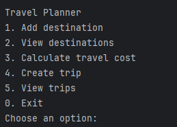

The application retains the destination, cost calculation, and trip management options from the previous laboratories. The existing menu is used to access the extended functionality.

**Figure 2. Nested activity categories created with Composite**

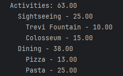

The Rome trip contains two category groups: Sightseeing (10.00 + 15.00 = 25.00) and Dining (13.00 + 25.00 = 38.00). The overall activities cost is 63.00. This demonstrates that the parent `ActivityGroup` uses the same `getCost()` method for child groups and individual activities.

**Figure 3. Entering optional service costs through the application**

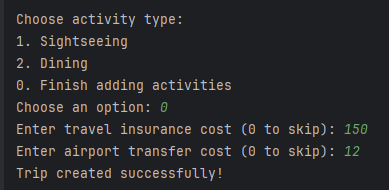

After the activities have been entered, the application accepts a travel insurance cost of 150.00 and an airport transfer cost of 12.00. The Facade applies the corresponding pricing decorators during trip creation.

**Figure 4. Trip price breakdown with both decorators**

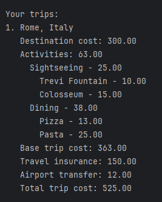

For Rome, the destination costs 300.00 and the activities cost 63.00, producing a base trip cost of 363.00. The `InsuranceDecorator` adds 150.00 and the `AirportTransferDecorator` adds 12.00. The calculated total is **525.00**. The displayed breakdown is supplied by the pricing components, not by duplicate fee fields in `TripBooking`.

**Figure 5. Skipping optional services**

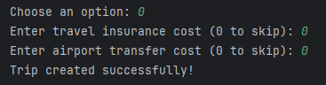

The user can enter 0 for insurance and airport transfer. In this case, the additional decorators are omitted and the trip can still be created normally.

**Figure 6. Completed trip without additional services**

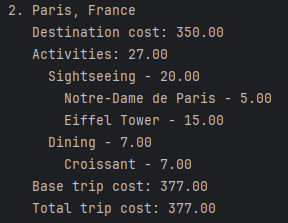

The Paris trip has a destination cost of 350.00 and activities costing 27.00. With no additional services selected, its base and final trip costs are both **377.00**.

**Figure 7. Multiple bookings saved and displayed**

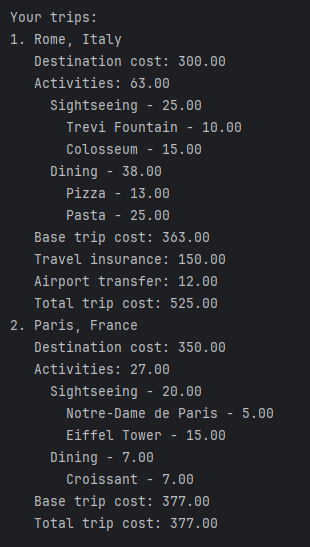

Both trips appear in the same application run, with their own destinations, Composite activity hierarchies, and individual pricing results. `TripManager` stores the bookings, each associating a `Trip` with its decorated `TripPrice`.

#### Automated tests

Six automated tests were run using `tests.AllTests`, with two tests for each structural pattern. The tests use Java assertion helpers rather than an external test framework.

| Pattern | Java test method | What is checked | Result |
|---|---|---|---|
| Composite | `testLeavesAndGroupsShareInterface()` | Leaf and group use `Activity` and calculate cost. | PASS |
| Composite | `testNestedGroupsCalculateTotal()` | Nested categories aggregate to 62.00. | PASS |
| Decorator | `testStackingAndPriceBreakdown()` | Stacked fees give 380.00 with three entries. | PASS |
| Decorator | `testWrappingDoesNotChangeBase()` | Both orders agree; original base stays 230.00. | PASS |
| Facade | `testFullTripCreation()` | A Facade operation integrates the patterns and stores a booking. | PASS |
| Facade | `testDestinationCostAndNoExtras()` | Destination calculation and no-extras trip are correct. | PASS |

**Test runner:** [AllTests.java](../src/test/tests/AllTests.java); assertion helpers: [Checks.java](../src/test/tests/Checks.java). The console log shown below is also preserved in [test-results.txt](test-results.txt).

**Figure 8. Automated test results in IntelliJ IDEA**

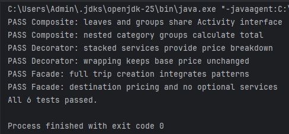

The console shows six `PASS` results, followed by `All 6 tests passed.` and `Process finished with exit code 0`. This confirms that the local test execution completed successfully.

To run the tests again in IntelliJ IDEA, mark `src/test` as **Test Sources Root**, open `src/test/tests/AllTests.java`, and run its `main()` method. Alternatively, from the project root in Windows PowerShell:

```powershell
New-Item -ItemType Directory -Force -Path out\lab2-test | Out-Null
$javaFiles = Get-ChildItem src\main,src\test -Recurse -Filter *.java | Select-Object -ExpandProperty FullName
javac -encoding UTF-8 -d out\lab2-test $javaFiles
java -cp out\lab2-test tests.AllTests
```

The results in Figure 8 come from the recorded IntelliJ execution. The test source files are located at [src/test/tests/](../src/test/tests/). A single PowerShell invocation compiles the sources and runs all six tests. Project setup and execution instructions are also documented in the project-root [README.md](../README.md).

### 3.6 How to Run

1. Open the existing Travel Planner project in IntelliJ IDEA.
2. Make sure `src/main` is marked as **Sources Root** and `src/test` is marked as **Test Sources Root**.
3. Use a JDK supporting Java records and the project's Java syntax (Java 17 or newer is suitable).
4. Run `app.Main` to use the Travel Planner menu.
5. Run `tests.AllTests` to execute the six automated checks.

No external dependencies, databases, or APIs are required.

## 4. Conclusion

This laboratory extended the Java Travel Planner application with three structural patterns. Composite organizes sightseeing and dining activities into nested groups through the existing `Activity` interface. Decorator combines a base trip price with optional service fees without adding those fields to `Trip`. Facade provides a higher-level entry point for operations that previously required the console code to coordinate multiple classes. These patterns are integrated into a single trip-creation workflow alongside the Builder, Factory Method, and Singleton patterns from Lab 1.

A key implementation challenge was maintaining a consistent activity model while introducing nested groups. The `Trip` and `TripBuilder` classes already accept `Activity` objects, so reusing that abstraction avoided changes to their construction logic. The cycle check in `ActivityGroup` also matters: without it, accidental circular nesting could cause endless recursion during cost calculation.

Another design decision concerned how to display individual fees. Initially, storing insurance and airport transfer amounts directly in `TripBooking` would have made the display simpler, but it would have duplicated state already owned by the pricing decorators. The final design instead uses `TripPrice.getBreakdown()` so each pricing component contributes its own entry. The separate booking object still serves a useful purpose by pairing the trip data with the decorated price.

Facade simplified the console substantially, but keeping its responsibility focused was more difficult than simply moving methods from `Main.java`. It coordinates destination services, the Factory Method creators, Composite groups, Builder construction, pricing, and Singleton storage. For a larger application, I would move detailed trip-construction and pricing coordination into dedicated services while retaining the Facade as the client-facing entry point.

An area for future improvement is extension of the available activity categories and optional services. New activity implementations can use the `Activity` interface and new pricing decorators can implement `TripPrice` without modifying the existing pattern classes. However, making a new category or service selectable in the current console workflow still requires changes to the Facade or menu logic. A configurable registry of activity creators and pricing options would better satisfy a strict open/closed interpretation without hard-coded selection branches. This limitation is not addressed by the report alone and would require a further code change.

The completed console exercises show a Rome trip costing 525.00 with both optional services and a Paris trip costing 377.00 without extras. The six automated tests passed, covering each structural pattern twice. The final result demonstrates how common interfaces and object composition can extend an existing application while maintaining compatibility with its earlier functionality.
