# Laboratory Work 3 - Behavioral Design Patterns

### Course: Techniques and Mechanisms of Software Design (TMPS)

### Project: Travel Planner

### Student: Felicia Ojog

### Academic Group: FAF-243

### Programming Language: Java

### Development Environment: IntelliJ IDEA

## 1. Introduction

The purpose of this laboratory work is to implement behavioral design patterns that define how objects communicate, how responsibilities are distributed, and how an application's behavior can change while it is running. The three patterns implemented are **Strategy**, **Observer**, and **Command**.

Lab 3 extends the existing Travel Planner console application. Lab 0 introduced destination management and cost calculation with SOLID principles. Lab 1 added Singleton, Builder, and Factory Method for creating and storing trips. Lab 2 added Composite for grouping activities, Decorator for optional trip services, and Facade for coordinating the application. Those features remain available.

### 1.1 Application Domain

Travel Planner lets a user add destinations, create trips containing sightseeing and dining activities, include optional estimated insurance and airport-transfer costs, and view the resulting prices. In Lab 3, the user can select a pricing policy at runtime, enable or disable console notifications about booking changes, and undo recent trip creation actions. The application uses in-memory data and user-entered prices; it does not make actual travel reservations.

## 2. Behavioral Design Patterns

### 2.1 Overview

Behavioral patterns distribute operations and communication between objects. The available patterns include Chain of Responsibility, Command, Interpreter, Iterator, Mediator, Memento, Observer, State, Strategy, Template Method, and Visitor. This laboratory implements Strategy, Observer, and Command because each addresses a concrete operation in the Travel Planner.

### 2.2 Strategy - Booking Pricing

**Intent.** Strategy defines interchangeable algorithms through a common interface and lets the application select one while running. A pricing policy can be changed without modifying the stored booking or the Decorator calculation.

The **Strategy** interface is `BookingPricingStrategy`, with methods `getName()` and `calculate(double)`. Its two **Concrete Strategies** are `StandardBookingPricing` and `StudentBookingPricing`. The **Context** is `BookingPricingContext`: it holds a reference to the currently selected `BookingPricingStrategy` and delegates the price calculation. `TravelPlannerFacade` exposes the context through the `TravelPlanner` abstraction. `Main.java` supplies the user's choice.

**Source files:** [BookingPricingStrategy.java](../src/main/patterns/behavioral/strategy/BookingPricingStrategy.java), [BookingPricingContext.java](../src/main/patterns/behavioral/strategy/BookingPricingContext.java), [StandardBookingPricing.java](../src/main/patterns/behavioral/strategy/StandardBookingPricing.java), [StudentBookingPricing.java](../src/main/patterns/behavioral/strategy/StudentBookingPricing.java).

The following excerpt from `BookingPricingContext.java` shows the runtime switch and delegation:

```java
private BookingPricingStrategy strategy;

public BookingPricingContext(BookingPricingStrategy strategy) {
    setStrategy(strategy);
}

public void setStrategy(BookingPricingStrategy strategy) {
    if (strategy == null) {
        throw new IllegalArgumentException("Pricing strategy is required.");
    }

    this.strategy = strategy;
}

public double calculatePrice(TripBooking booking) {
    if (booking == null) {
        throw new IllegalArgumentException("Booking is required.");
    }

    return strategy.calculate(booking.getPrice().getCost());
}
```

The context does not test which concrete strategy it holds. At runtime, it simply calls the `calculate()` method through the interface. For example, a booking with a decorated cost of 300.00 produces 300.00 with standard pricing and 270.00 with the student strategy (10% discount). The booked `TripPrice` object still contains its original cost.

**UML Class Diagram: Strategy**

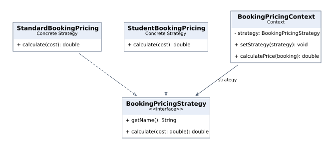

[Editable diagram source](diagrams/strategy-uml.mmd)

**Automated unit tests:** [StrategyTests.java](../src/test/tests/StrategyTests.java)

| Test method | Property verified | Result |
|---|---|---|
| `testStrategiesProduceExpectedPrices()` | Standard pricing returns 300.00 and student pricing returns 270.00 for the same booking, while the decorated cost stays 300.00. | PASS |
| `testFacadeSwitchesStrategiesAtRuntime()` | The Facade changes strategies from standard to student and back, producing 120.00, 108.00, and 120.00 without replacing the booking. | PASS |

### 2.3 Observer - Booking Notifications

**Intent.** Observer lets a subject notify registered listeners when its state changes without depending on their concrete classes. Subscriptions can be added and removed during execution.

The **Subject** is `TripManager`, which remains the Singleton from Lab 1. It stores a `List<BookingObserver>` and provides `addObserver()` and `removeObserver()`. `BookingObserver` is the **Observer interface**. `ConsoleBookingObserver` and `BookingHistoryObserver` are two **Concrete Observers**. A `BookingEvent` record carries the affected booking and an event type, `CREATED` or `REMOVED`.

**Source files:** [TripManager.java](../src/main/patterns/creational/singleton/TripManager.java), [BookingObserver.java](../src/main/patterns/behavioral/observer/BookingObserver.java), [ConsoleBookingObserver.java](../src/main/patterns/behavioral/observer/ConsoleBookingObserver.java), [BookingHistoryObserver.java](../src/main/patterns/behavioral/observer/BookingHistoryObserver.java), [BookingEvent.java](../src/main/patterns/behavioral/observer/BookingEvent.java).

The following excerpt from `TripManager.java` shows subscriber management and notification:

```java
public void addObserver(BookingObserver observer) {
    if (observer == null) {
        throw new IllegalArgumentException("Observer is required.");
    }

    if (!observers.contains(observer)) {
        observers.add(observer);
    }
}

public void removeObserver(BookingObserver observer) {
    observers.remove(observer);
}

private void notifyObservers(BookingEvent event) {
    for (BookingObserver observer : List.copyOf(observers)) {
        observer.onBookingEvent(event);
    }
}
```

When `TripManager.addBooking()` succeeds, it publishes a `CREATED` event. When `removeBooking()` succeeds, it publishes a `REMOVED` event. The console observer prints a notification; the history observer records an event in memory. The copied subscriber list allows the notification loop to iterate over a stable snapshot.

**UML Class Diagram: Observer**

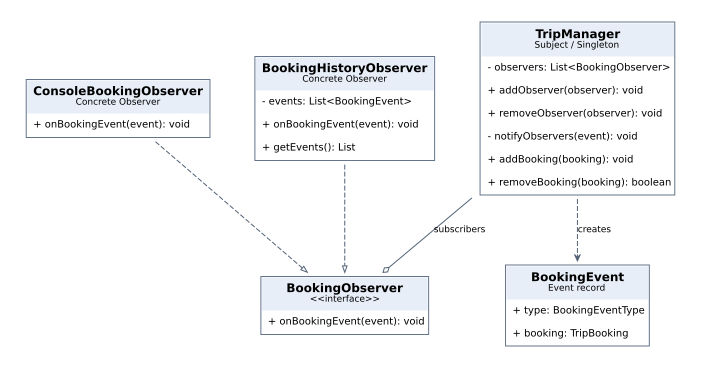

[Editable diagram source](diagrams/observer-uml.mmd)

**Automated unit tests:** [ObserverTests.java](../src/test/tests/ObserverTests.java)

| Test method | Property verified | Result |
|---|---|---|
| `testSubscribedObserversReceiveCreation()` | A registered history observer receives exactly one `CREATED` event with the same saved booking. | PASS |
| `testUnsubscribedObserversStopReceivingEvents()` | After removing the observer, later booking creation does not add another event to its history. | PASS |

### 2.4 Command - Reversible Booking Creation

**Intent.** Command encapsulates a request as an object, separating the object that requests an action from the object that performs it. A command history supports undo.

`BookingCommand` is the **Command interface**, defining `execute()` and `undo()`. `CreateBookingCommand` is the **Concrete Command**. `TripManager` is the **Receiver** that actually stores and removes bookings. `BookingCommandInvoker` is the **Invoker** with a stack of commands. `TravelPlannerFacade` acts as the client that constructs a command and submits it to the invoker.

**Source files:** [BookingCommand.java](../src/main/patterns/behavioral/command/BookingCommand.java), [CreateBookingCommand.java](../src/main/patterns/behavioral/command/CreateBookingCommand.java), [BookingCommandInvoker.java](../src/main/patterns/behavioral/command/BookingCommandInvoker.java), [TravelPlannerFacade.java](../src/main/patterns/structural/facade/TravelPlannerFacade.java).

The following excerpt from `BookingCommandInvoker.java` demonstrates execution and reverse-order undo:

```java
private final Deque<BookingCommand> history = new ArrayDeque<>();

public void execute(BookingCommand command) {
    if (command == null) {
        throw new IllegalArgumentException("Command is required.");
    }

    command.execute();
    history.push(command);
}

public boolean undoLast() {
    if (history.isEmpty()) {
        return false;
    }

    BookingCommand command = history.peek();
    command.undo();
    history.pop();
    return true;
}
```

Each executed command is stored on a stack. `undoLast()` reverses the most recent successful command. The actual booking operations remain in `TripManager`, not in the invoker. Because booking creation and removal publish Observer events, undo also results in a `REMOVED` notification for subscribed listeners.

**UML Class Diagram: Command**

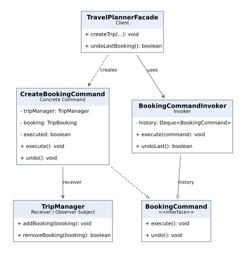

[Editable diagram source](diagrams/command-uml.mmd)

**Automated unit tests:** [CommandTests.java](../src/test/tests/CommandTests.java)

| Test method | Property verified | Result |
|---|---|---|
| `testFacadeCreationCanBeUndoneAndNotifiesObservers()` | Creating and undoing a booking returns the booking count to its previous value and produces `CREATED` then `REMOVED` events. A second undo reports no command. | PASS |
| `testInvokerUndoesCommandsInReverseOrder()` | Two created bookings are undone in last-in-first-out order, leaving the first booking after the first undo and none after the second. | PASS |

## 3. Implementation

### 3.1 Project Structure

The application remains in the same Java/IntelliJ project. Its source and documentation are grouped as follows:

```text
TravelPlanner/
  lab0/
  lab1/
  lab2/
  lab3/
    REPORT.md
    diagrams/
      strategy-uml.svg
      observer-uml.svg
      command-uml.svg
    test-results.txt
    screenshots/
      main-menu.png
      strategy-switching.png
      observer-creation.png
      observer-disable.png
      booking-without-notification.png
      saved-bookings.png
      command-undo-notification.png
      automated-tests.png
  src/
    main/
      app/Main.java
      model/
      solid/
      patterns/
        creational/
          builder/
          factorymethod/
          singleton/
        structural/
          composite/
          decorator/
          facade/
        behavioral/
          strategy/
          observer/
          command/
    test/
      tests/
        AllTests.java
        Checks.java
        StrategyTests.java
        ObserverTests.java
        CommandTests.java
        CompositeTests.java
        DecoratorTests.java
        FacadeTests.java
```

The complete source code for the application entry point is [Main.java](../src/main/app/Main.java). The three behavioral packages are located under [patterns/behavioral](../src/main/patterns/behavioral/).

### 3.2 Application Workflow

The previous destination and trip operations remain available. Lab 3 adds these menu operations:

```text
6. Calculate booking price
7. Toggle booking notifications
8. Undo last trip creation
```

Option 6 prompts the user to select an existing booking, then choose Standard or Student pricing. The same booking is priced repeatedly using the selected strategy. Option 7 registers or removes the console observer. Option 8 asks the Facade to undo the most recently created trip in the current command history. The program still uses menu option 4 to create a trip and option 5 to display its stored price breakdown.

### 3.3 Pattern Interaction

One normal execution path combines new and existing patterns:

```text
Main (console client)
  -> TravelPlanner interface / TravelPlannerFacade [Facade]
       -> Factory Method creates individual activities
       -> Composite groups them into categories
       -> Builder constructs the Trip
       -> Decorator calculates its optional service fees
       -> CreateBookingCommand [Command]
            -> TripManager [Singleton + Observer subject]
                 -> subscribed BookingObserver instances [Observer]

Main -> TravelPlannerFacade -> BookingPricingContext [Strategy]
     -> selected BookingPricingStrategy applied to the decorated booking cost

Main -> TravelPlannerFacade -> BookingCommandInvoker.undoLast() [Command]
     -> CreateBookingCommand.undo() -> TripManager.removeBooking()
     -> Observer publishes REMOVED event
```

This is not three separate demonstrations: Command and Observer interact directly in both creation and undo, and Strategy operates on the `TripBooking` produced by the existing structural patterns.

### 3.4 Runtime Behavior and Validation

The Strategy changes during execution through `setStrategy()`. Observer subscriptions change during execution through `addObserver()` and `removeObserver()`. Both are performed through abstractions. The booking command is executed or undone through the `BookingCommand` interface. Validation rejects invalid activity selections, missing activities, negative or non-finite prices, null strategies, and invalid commands. Undo returns `false` when the command history is empty.

The pricing policy selected in option 6 is used to calculate and display a quote; it **does not change the original `TripBooking` price**. The earlier student discount in menu option 3 calculates a destination estimate, while Strategy in option 6 operates on the complete decorated booking cost. This distinction prevents confusing the two calculations.

### 3.5 Automated Testing and Results

All twelve tests in [AllTests.java](../src/test/tests/AllTests.java) were compiled and executed together. Six test cases are inherited from Lab 2, and six cover the three new behavioral patterns. The results were:

```text
PASS Composite: leaves and groups share Activity interface
PASS Composite: nested category groups calculate total
PASS Decorator: stacked services provide price breakdown
PASS Decorator: wrapping keeps base price unchanged
PASS Facade: full trip creation integrates patterns
PASS Facade: destination pricing and no optional services
PASS Strategy: standard and student prices are correct
PASS Strategy: Facade switches strategies at runtime
PASS Observer: subscribed observers receive creation events
PASS Observer: unsubscribed observers receive no further events
PASS Command: trip creation undo and Observer notification
PASS Command: undo follows reverse execution order
All 12 tests passed.
```

The exact recorded output is in [test-results.txt](test-results.txt). These are automated Java tests using the existing `Checks` assertion helpers and `AllTests` runner, not JUnit tests. Figure 8 shows the execution in IntelliJ IDEA and the successful exit code. The source snapshot was compiled and the same twelve tests passed during the report verification.

### 3.6 Console Execution Screenshots

The following figures document actual runs of the completed application in IntelliJ IDEA. They are taken from the supplied Lab 3 execution captures. Values shown are user-entered estimated costs, not real reservation prices.

**Figure 1. Main menu after implementing the behavioral patterns**

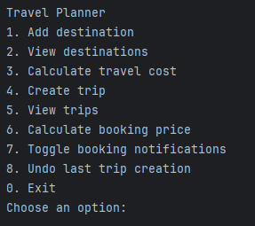

The menu retains destination and trip operations from previous labs and includes booking pricing (option 6), notification subscriptions (option 7), and undo (option 8).

**Figure 2. Strategy selection and runtime switching**

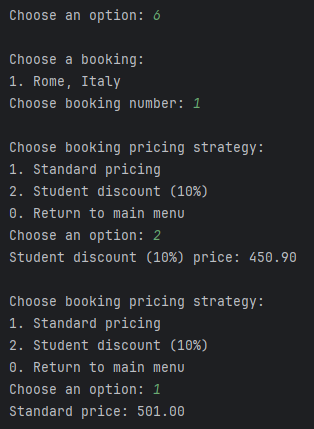

The same Rome booking is calculated using the student strategy, giving **450.90**, and then the standard strategy, giving **501.00**. The student price is 90% of the standard amount. The stored booking is not modified when the pricing policy changes.

**Figure 3. Observer notification on booking creation**

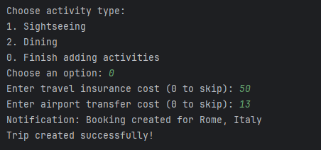

After the user enters insurance of **50.00** and an airport transfer of **13.00**, the console reports `Notification: Booking created for Rome, Italy`. This demonstrates that `TripManager` publishes an event to its subscribed console observer.

**Figure 4. Unsubscribing from console notifications at runtime**

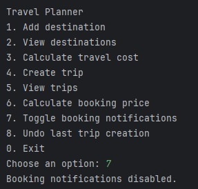

Option 7 prints `Booking notifications disabled.` The notification listener is removed while the application continues to run. This is a runtime subscription change, not a change to the trip-creation algorithm.

**Figure 5. Creating a booking with optional fees skipped**

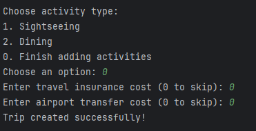

In the captured scenario, the user enters **0** for travel insurance and airport transfer. The booking is created successfully. This capture is also consistent with the notification-disabled scenario: the creation succeeds without displaying the usual booking-created console notification. The report does not treat an absence of a notification in one capture alone as proof of unsubscription; Figure 4 documents the explicit toggle.

**Figure 6. Two bookings and their original decorated prices**

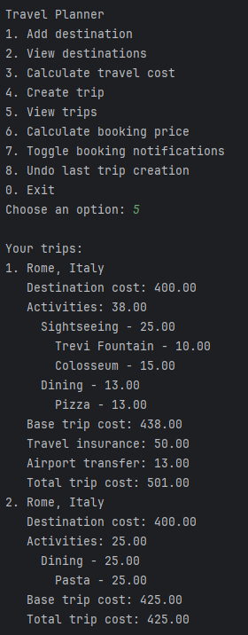

The displayed bookings demonstrate that Lab 3 continues to use the existing Composite activity groups and Decorator price calculations. The first Rome trip has a destination cost of **400.00**, activities of **38.00**, insurance of **50.00**, and transfer of **13.00**, for **501.00**. A second trip has base and final price **425.00**, without additional service fees.

**Figure 7. Command Undo and Observer removal notification**

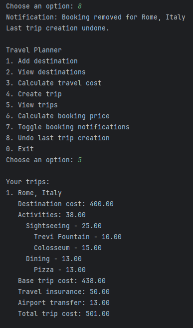

The user selects option 8. The console reports `Notification: Booking removed for Rome, Italy` followed by `Last trip creation undone.` Viewing the trips afterward shows the remaining booking, demonstrating that Command reverses the last creation and Observer reports the resulting state change.

**Figure 8. Twelve automated tests passing**

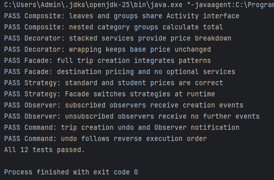

IntelliJ reports all twelve `PASS` results, the final `All 12 tests passed.` line, and process exit code **0**. This includes the six tests from Lab 2 and two tests each for the three new behavioral patterns.

### 3.7 How to Run

Open the TravelPlanner project in IntelliJ IDEA using a JDK compatible with Java records (JDK 17 or later). Mark `src/main` as **Sources Root** and `src/test` as **Test Sources Root**. Run `app.Main` for the application or `tests.AllTests` for all tests. Build, run, and one-command test instructions are provided in the [project README](../README.md).

## 4. Conclusions

The laboratory extends the existing Travel Planner with three behavioral patterns and shows how they cooperate with the structural and creational patterns from the preceding work. Strategy isolates price calculation behind an interchangeable interface. Observer separates the component that changes bookings from components interested in those changes. Command represents booking creation as an executable object and provides reverse-order undo through a dedicated invoker.

The most challenging design decision was how to integrate the new functionality without changing the `Trip` model or replacing Decorator's stored booking price. The chosen Strategy calculates a separate quoted amount based on the decorated total. This preserves the base booking while allowing the pricing behavior to change at runtime. Another consideration was that `TripManager` already stored bookings as a Singleton, making it a suitable Observer subject and Command receiver, although it now has more than one responsibility.

A useful alternative would be to move observer management out of `TripManager` and into a dedicated booking service or event publisher if the application grew. A second improvement would be to register available pricing strategies and activity creators in a configurable registry, rather than adding more menu conditionals for each new option. A larger application might also persist command history to support undo after a restart; in this laboratory, commands and data exist only during the current run.

Overall, Strategy, Observer, and Command satisfy different needs while sharing an actual user workflow. The automated tests verify runtime policy switching, subscriber notifications, and reversible booking operations. The implementation remains small enough to explain and extend while demonstrating how behavioral design patterns can reduce coupling between collaborating objects.
